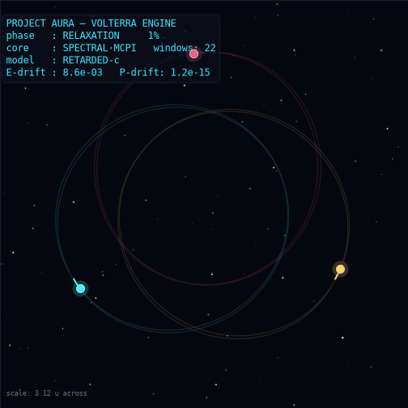
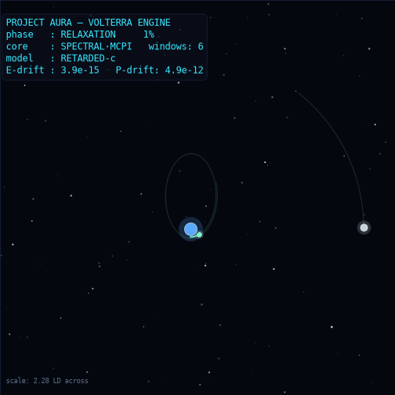
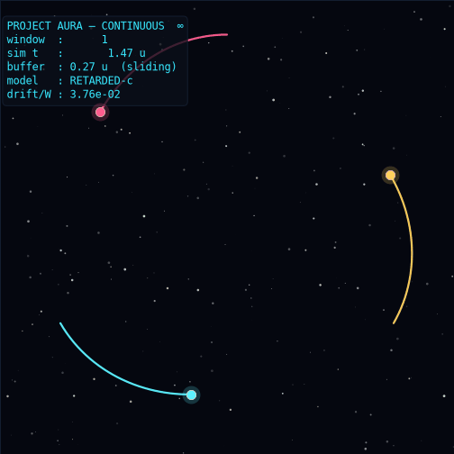

<div align="center">

# ◤ Project AURA
### Volterra N-Body Engine

**A global waveform-relaxation orbital engine — no step-by-step integration.**

Instead of marching one timestep at a time (RK4 / Verlet), AURA solves the
*entire trajectory at once* by Anderson‑accelerated Picard iteration of the
**Volterra integral form** of the equations of motion — on a **spectral
Chebyshev (MCPI)** core, with aberration‑corrected **retarded gravity**, full
**Einstein–Infeld–Hoffmann 1PN** dynamics, and an **infinite‑horizon Continuous
Mode** that streams forever on `O(1)` memory.


 

</div>

---

## The idea in one paragraph

The equations of motion `r'' = a(r)` are a boundary/initial‑value problem. AURA
rewrites them as a **Volterra integral equation of the second kind**

$$
\mathbf{r}_i(t) \;=\; \underbrace{\mathbf{r}_i(0) + \mathbf{v}_i(0)\,t}_{\text{ballistic predictor}}
\;+\; \int_0^{t} (t-s)\,\mathbf{a}_i\!\big[\mathbf{r}\big](s)\,\mathrm{d}s ,
$$

and solves it by **relaxation**: start from the straight ballistic guess, evaluate
the acceleration over the *whole* time grid, apply the double‑integral operator to
the *whole* grid in a single matrix product, under‑relax, and repeat. The
trajectory literally *bends into orbit*. That morphing is the "waveform
relaxation" you see in the animations.

---

## Gallery

| Inner Solar System | Earth · Moon · Spacecraft |
|:---:|:---:|
|  |  |
| **Sun, Venus, Earth, Mars.** Retardation on, but at the true speed of light it is a sub‑second, machine‑precision perturbation. | **AURA‑1 on an eccentric arc** toward the Moon and back, solved on chained global windows. |

| Deep Chaos (3‑Body) | Custom Sandbox |
|:---:|:---:|
|  |  |
| **Bounded chaotic tangle** with a deliberately *lowered* speed of gravity so retarded potentials smear the interactions. | **Randomised bodies** about a shared barycentre — re‑roll to spawn a new universe. |

> The GIFs above are generated by `python scripts/render_gif.py all`. Replace them
> with your own screen recordings of the live app any time — the paths stay the same.

---

## Architecture — integral vs. step‑by‑step

```
  STEP-BY-STEP (RK4 / Verlet)            GLOBAL WAVEFORM RELAXATION (AURA)
  ───────────────────────────            ─────────────────────────────────
  state at t0                            guess the WHOLE path r(t)  (ballistic)
     │  evaluate a, take a tiny step        │  evaluate a[r](t) on the whole grid
     ▼                                       ▼
  state at t1                            r ← (1-w)·r + w·( r0 + v0 t + K₂·a )
     │  ...error accrues, one step          │  under-relaxed Picard sweep
     ▼  at a time...                         ▼  the entire trajectory improves
  state at tN                            repeat until the path stops moving
```

**Predictor → Corrector.** The *predictor* is the inertial ballistic path
`r0 + v0·t`. The *corrector* is the Volterra operator applied globally.

**The global operator.** On a uniform grid the double integral becomes a single
lower‑triangular (causal) matrix `K₂`, so one Picard sweep is

$$
\mathbf{R}^{(k+1)} \;=\; \mathbf{R}_0 + \mathbf{V}_0\,t \;+\; K_2\,\mathbf{A}\!\left[\mathbf{R}^{(k)}\right],
\qquad K_2 = C\,C,
$$

where `C` is the cumulative trapezoid operator (`v = v0 + C·a`). `K₂·A` is a single
BLAS `gemm` — on Apple silicon it maps straight onto the **Accelerate** framework,
so the whole trajectory relaxes in one vectorised matrix product per iteration.

**Accelerated relaxation.** The fixed point `R = base + K₂·A(R)` is driven by
**Anderson acceleration** (a small least‑squares mix of recent residuals) rather
than plain damping — it converges in far fewer iterations and to a tighter
tolerance. Damped Picard (`R ← (1-w)R + w·Picard(R)`) remains available. Long /
chaotic / infinite horizons chain short global windows — **segmented and streaming
Picard–Chebyshev (MCPI)**; each window is still solved globally.

> The methods below (spectral quadrature, physical retardation, EIH, conservation
> diagnostics) are the **v0.3 advanced core** — see the dedicated section further down.

---

## Architectural Innovation: Piecewise Volterra & Sliding Delay Buffers

<div align="center">



*Continuous Mode — the global solve slid forward window‑by‑window, forever, on `O(1)` memory.*

</div>

A global Volterra solve is holistically accurate but **cannot run to infinity**. A
step‑by‑step marcher runs forever but **drifts** and **chokes on retarded
potentials**. Project AURA's Continuous Mode resolves this tension with a hybrid:
**Piecewise Volterra Windowing** with a **sliding delay buffer**.

### The dilemma

| Approach | Infinite horizon | Retarded potentials | Long‑term drift |
|---|:---:|:---:|:---:|
| **Step‑by‑step** (RK4, Gauss–Jackson) | ✅ streams naturally | ❌ must interpolate an ever‑growing past‑memory tape at every micro‑step | ❌ local truncation error accumulates every step |
| **Global Volterra** (one big window) | ❌ operator is `K × K` for `K` samples → `O(K²)` memory & compute | ✅ the whole history is *present*; delays are exact | ✅ the integral form re‑anchors to fixed endpoints |
| **Piecewise Volterra** (this work) | ✅ **windowed, streams forever** | ✅ **sliding buffer holds exactly the past the delays need** | ✅ **each window re‑anchors to a fresh epoch** |

The step‑by‑step cost of retardation is easy to underestimate: to evaluate
$\mathbf a\big(\mathbf r(t-\tau)\big)$ a marcher must reach back into a growing tape
of stored states and interpolate — every substep, for every pair, at every light
delay. A global Volterra solve makes that free (the past is simply *part of the
unknown*), but pays with an $O(K^2)$ dense causal operator that explodes as the
horizon $K \to \infty$.

### The solution — segment, anchor, slide

Time is cut into fixed windows $W_k = [T_k,\, T_{k+1}]$ of width $W = T_{k+1}-T_k$.
On each window we run the **local** global relaxation

$$
\mathbf{r}^{(n+1)}(t) \;=\; \mathbf{r}(T_k) \;+\; \mathbf{v}(T_k)\,(t - T_k)
\;+\; \int_{T_k}^{t} (t-s)\,
\mathbf{a}\!\Big(s,\; \mathbf{r}^{(n)}_{\text{buffer}}(s - \tau)\Big)\, ds ,
\qquad t \in [T_k, T_{k+1}] ,
$$

where the retarded lookup $\mathbf{r}^{(n)}_{\text{buffer}}(s-\tau)$ reads from the
**current window iterate** when $s-\tau \ge T_k$, and otherwise from the **sliding
delay buffer** — the physically real tail of already‑converged history. Once the
window has relaxed:

1. **Anchor.** Freeze the final vector $\big(\mathbf r(T_{k+1}),\, \mathbf v(T_{k+1})\big)$ as the new epoch — the initial condition for $W_{k+1}$.
2. **Slide the buffer.** Keep only the trailing slice of length
   $$ \Delta_\text{buf} \;=\; \eta \,\tau_{\max} \;=\; \eta\,\frac{\max_{i,j}\lVert \mathbf r_i - \mathbf r_j\rVert}{c}, \qquad \eta \approx 2.5 , $$
   i.e. exactly the light‑crossing history the next window's retarded potentials can reach ($c\,\tau_{\max}$ of past), resampled onto a fixed grid.
3. **Discard.** Everything older than $\Delta_\text{buf}$ is dropped. The window itself is emitted to the renderer and released.

```
        past  ─────────────────────────────►  future
                       ┌───────────────┐
   … discarded …  ▓▓▓▓▓│   window W_k   │      W_{k+1}  (not yet computed)
                  └─┬─┘ └───────┬───────┘
             delay buffer      epoch (r,v) @ T_{k+1}  ──►  seeds next window
             (length η·τ_max)   the buffer's leading edge slides here after solve
```

### Why this is the important part

Let the window hold $W$ samples and the buffer $B$ samples with $B \ll W$. Then:

$$
\underbrace{\text{compute}}_{\text{per window}} = O(W^2) \;\text{(vs. } O(t^2)\text{ global)}
\qquad
\underbrace{\text{live memory}}_{\text{steady state}} = O(W + B) = O(1) \;\text{in } t .
$$

- **`O(1)` memory over an infinite horizon.** The operator matrices, the window, and
  the buffer are all fixed size. RAM does not grow no matter how long you run —
  the loop can spin for a million windows on a laptop.
- **Bounded, non‑accumulating cost.** Each window costs the *same* $O(W^2)$; there is
  no $O(t^2)$ blow‑up and no ever‑lengthening memory tape to interpolate.
- **Drift resistance.** Because each window is solved as a *boundary‑anchored
  integral equation* (not a chain of local extrapolations), truncation error does
  not compound the way it does in RK‑style marchers — the relaxation re‑anchors to
  a fresh epoch every window.
- **Holistic delay resolution.** Within a window the retarded potentials still see
  the *entire* trajectory at once (global), and the sliding buffer carries the real
  past across the seam — so finite‑speed gravity is resolved consistently across
  window boundaries, not faked by ballistic guessing.

The result is the numerical character of Waveform Relaxation — global, drift‑
resistant, delay‑exact — running with the runtime and memory profile of a real‑time
flight computer. Flip **Continuous Mode** on and it never stops.

> Requirement: the design assumes $\Delta_\text{buf} \le W$ (the longest light delay
> is shorter than one window), which holds for every preset. AURA sizes the buffer
> from the live system diameter each window, so it adapts automatically; if a delay
> ever exceeded the buffer it is clamped to the oldest retained sample.

---

## The Advanced Core (v0.3)

Five upgrades take AURA from a clean PoC to a research‑grade engine. Each is
**selectable** and **measured** (`tests/test_physics.py`, `scripts/tune.py`).

### 1 · Spectral quadrature (MCPI) — `scheme="chebyshev"`

More Picard iterations **don't** raise accuracy past the discretisation floor —
the *quadrature* does. Trapezoid is `O(dt²)`; the Chebyshev–Gauss–Lobatto scheme
(Modified Chebyshev‑Picard Iteration) is **spectral**. On the `sin` double‑integral
at equal node counts:

$$\text{trapezoid error} \approx 3\times10^{-3} \qquad\longrightarrow\qquad \text{Chebyshev error} \approx 9\times10^{-16}$$

— twelve orders of magnitude, and a far larger convergence radius per window
(fewer nodes, bigger windows). The spacecraft's eccentric orbit conserves energy to
`3.9e‑15` (machine precision).

### 2 · Physically‑correct retardation — `retardation="aberration"` (default)

Naive retarded gravity uses the source's retarded *position* only — which breaks
Newton's third law and produces a spurious secular drift. Real gravity's
velocity‑dependent terms **cancel the aberration** (Carlip 2000), so AURA
extrapolates the source forward by the light‑time, $\mathbf r_\text{ret} + \tau\,\mathbf v_\text{ret}$,
with the light‑cone equation solved by **Newton iteration**. On the chaotic triple:

| retardation | energy drift | angular‑momentum drift |
|---|---|---|
| `"naive"` (the textbook strawman) | `0.92` | `0.41` |
| `"aberration"` (physical, default) | **`8.6e‑3`** | **`2.1e‑3`** |

Two orders of magnitude better conservation — and you can flip to `"naive"` to
*watch* the artifact appear.

### 3 · Full Einstein–Infeld–Hoffmann 1PN — `pn="eih"`

The complete EIH n‑body 1PN acceleration (harmonic gauge), not a reduced pairwise
term. It is **momentum‑conserving** (derived from a Lagrangian) and gives the
correct **prograde** perihelion advance for comparable masses:

| PN model | perihelion advance | momentum drift |
|---|---|---|
| `"reduced"` (Schwarzschild pairwise) | prograde ✓ | `8.9e‑2` |
| `"eih"` (full 1PN) | prograde ✓ | **`5e‑4`** |

### 4 · Anderson‑accelerated Picard — `accelerator="anderson"` (default)

A least‑squares mix of recent residuals replaces hand‑tuned damping. On the inner
Solar System it converges in **32 iterations vs 54** for damped Picard, *and* to a
tighter residual.

### 5 · Conservation diagnostics + self‑consistent velocities

Every solve reports **energy, linear‑momentum and angular‑momentum drift**. The
velocity fed into the force model is the Volterra velocity `V = V₀ + C·A` (not a
finite difference), and the predictor is the Taylor form `r₀ + v₀t + ½a₀t²` — both
cut iterations and keep the physics self‑consistent. Interpolation of the retarded
past is **barycentric‑Lagrange** (spectral) on CGL nodes, **cubic‑Hermite** on the
delay buffer.

---

## Is the physics real? (yes — and measured)

This repo does **not** hand‑wave. Every row is checked in `tests/test_physics.py`
(19 tests) and reproduced by `python scripts/tune.py`:

| Property | Result |
|---|---|
| Chebyshev vs trapezoid, `sin` double‑integral | `9e‑16` vs `3e‑3` (**spectral**) |
| Barycentric interpolation of a smooth function | error `< 1e‑10` |
| Circular two‑body: closes, conserves E / P / L | all drifts `< 1e‑6` |
| Spacecraft eccentric orbit, energy | drift `3.9e‑15` |
| **Newtonian** chaotic triple, energy / momentum | `< 1e‑6` / `< 1e‑9` |
| **Aberration** vs **naive** retardation (chaos) | E `8.6e‑3` vs `0.92`; L `2.1e‑3` vs `0.41` |
| **EIH** circular orbit | stable, drift `~1e‑6` |
| **EIH** eccentric orbit | **prograde** precession, momentum drift `< 1e‑2` |
| Anderson vs damped Picard (solar) | **32 vs 54** iterations |
| **Continuous stream** window joins | `C⁰` continuity, gap `< 1e‑9` |
| **Continuous stream** memory over 25+ windows | bounded (delay buffer never grows) |
| **Continuous stream** momentum (aberration) | drift `< 1e‑6` |

The retardation pair is the honest headline: with **instantaneous** gravity the
spectral integrator conserves energy to machine precision *through chaotic close
encounters*; the **naive** finite‑`c` model drifts by `~0.9` (a real, well‑known
artifact); and the **aberration‑corrected** model — the physically defensible one —
brings that back down by two orders of magnitude. The engine tells the truth about
whichever model you select.

> ⚠️ **Honesty note.** Even the aberration‑corrected retardation is a *linearised*
> finite‑speed model, not full numerical relativity; the EIH term is 1PN (no 2PN /
> spin / radiation‑reaction). What is rigorous is that each model conserves exactly
> what its symmetry says it should, and the diagnostics prove it.

---

## Features

- **Spectral MCPI core:** Chebyshev–Gauss–Lobatto quadrature with barycentric interpolation — exponential accuracy, machine‑precision orbits.
- **Physical retardation + full EIH 1PN:** aberration‑cancelling finite‑`c` gravity and momentum‑conserving post‑Newtonian dynamics, both measured.
- **Anderson‑accelerated relaxation** and live **energy / momentum / angular‑momentum** conservation diagnostics.
- **∞ Continuous Mode:** Piecewise Volterra Windowing with a sliding delay buffer — runs *indefinitely* on `O(1)` memory, with adaptive window subdivision.
- **Four presets:** Inner Solar System · Earth‑Moon‑Spacecraft · Deep Chaos 3‑body · randomised Sandbox.
- **Sleek dark cockpit** (`customtkinter`) with an embedded, blitted Matplotlib canvas and a live physics HUD.
- **Live controls:** scenario selector, relaxation‑depth slider, damping `w`, retardation & 1PN switches, continuous‑mode switch, playback speed, play/pause/restart, sandbox re‑roll.
- **Non‑blocking:** batch solves and the infinite stream both run on a worker thread + bounded queue; the UI never freezes.
- **Headless tooling:** GIF renderer (incl. `continuous`), tuning harness, and a `pytest` validation suite (19 tests).

---

## Quickstart (macOS · Apple Silicon)

AURA needs a Python with working **Tcl/Tk** (the python.org framework build or
Homebrew's `python-tk` both work). Then:

```bash
git clone https://github.com/<you>/aura-volterra-engine.git
cd aura-volterra-engine

python3 -m venv .venv
source .venv/bin/activate
pip install -r requirements.txt

python main.py            # launch the cockpit
```

If `import tkinter` fails, install Tk for your Python:

```bash
brew install python-tk            # Homebrew python
# or use the installer from https://www.python.org/downloads/macos/
```

### Other commands

```bash
python scripts/render_gif.py all              # regenerate assets/*.gif (+ continuous.gif)
python scripts/render_gif.py "Deep Chaos (3-Body)" out.gif
python scripts/render_gif.py continuous "Deep Chaos (3-Body)" cont.gif   # infinite-run clip
python scripts/tune.py                         # convergence / energy report
python -m pytest -q                            # run the validation suite (17 tests)
```

In the app, flip **Continuous Mode (∞ infinite run)** to switch from the
finite two‑phase animation to the endless Piecewise‑Volterra stream — the view
follows the system, the HUD shows the live window index, sim‑time and sliding
delay‑buffer length, and it runs until you toggle it off.

---

## Project structure

```
aura-volterra-engine/
├── main.py                     # customtkinter cockpit (entry point)
├── aura_engine/
│   ├── operators.py            # trapezoid + spectral Chebyshev (MCPI) operators, barycentric interp
│   ├── physics.py              # engine core, EIH, retardation models, Anderson, VolterraSystem + stream
│   ├── presets.py              # the four scenarios + engine settings
│   └── viz.py                  # shared scenes: TrajectoryScene (batch) + ContinuousScene (∞)
├── scripts/
│   ├── render_gif.py           # headless GIF export (batch + `continuous`)
│   └── tune.py                 # per-preset convergence/energy diagnostics
├── tests/test_physics.py       # operators, orbit, energy, PN, streaming, preset tests
├── requirements.txt
└── assets/                     # generated animations (incl. continuous.gif)
```

---

## How a single iteration works (under the hood)

```python
from aura_engine import get_preset, VolterraSystem

cfg    = get_preset("Solar System (Inner)")
system = cfg.build(scheme="chebyshev",            # spectral MCPI (default)
                   accelerator="anderson",        # Anderson-accelerated Picard
                   retardation="aberration",      # physical finite-c gravity
                   pn="none")                      # or "eih" for full 1PN
result = system.propagate(iterations=60, n_segments=cfg.n_segments)

print(result.converged, result.energy_drift,      # True  5.0e-10
      result.momentum_drift, result.angmom_drift) # conservation diagnostics
traj = result.trajectory                          # (n_nodes, n_bodies, 3)
```

Inside `relax()` each sweep is literally:

```python
A          = self.accelerations(R)                # (n, N, 3) retarded + softened + 1PN
picard     = R0 + V0 * t + apply_operator(K2, A)  # one BLAS gemm over the time axis
R          = (1 - w) * R + w * picard             # under-relax
```

And the **infinite** run is just a loop over windows that never ends:

```python
from aura_engine import PiecewiseVolterraStream, get_preset

cfg    = get_preset("Deep Chaos (3-Body)")
stream = PiecewiseVolterraStream.from_config(
    cfg, iterations=cfg.iterations, relaxation=cfg.relaxation,
    use_retardation=True, use_pn=False)

for window in stream:                 # never terminates; RAM stays O(1)
    plot(window.t, window.trajectory) # each window is a slice [T_k, T_{k+1}]
    # stream.buffer_span  -> current sliding delay-buffer length (c·τ_max)
    # stream.window_index -> monotonically increasing forever
```

---

## Limitations & future work

- **Delay‑buffer assumption.** Continuous Mode assumes the longest light delay is
  shorter than one window (`Δ_buf ≤ W`); true for all presets. Delays longer than the
  retained buffer are clamped to its oldest sample.
- **Retardation is linearised.** The aberration‑corrected model is `O(v/c)` correct,
  not full numerical relativity; the EIH term is 1PN (no 2PN / spin / radiation).
- **Softening vs. regularisation.** A Plummer softening length regularises close
  encounters; Kustaanheimo–Stiefel / Sundman regularisation (true collision handling)
  is future work, as is a Barnes–Hut / FMM tree for large‑`N` (both deliberately
  deferred — they trade the clean spectral‑matrix engine for scaling, not accuracy).

---

## License

MIT — see [LICENSE](LICENSE). Built as a proof of concept; PRs and forks welcome.
